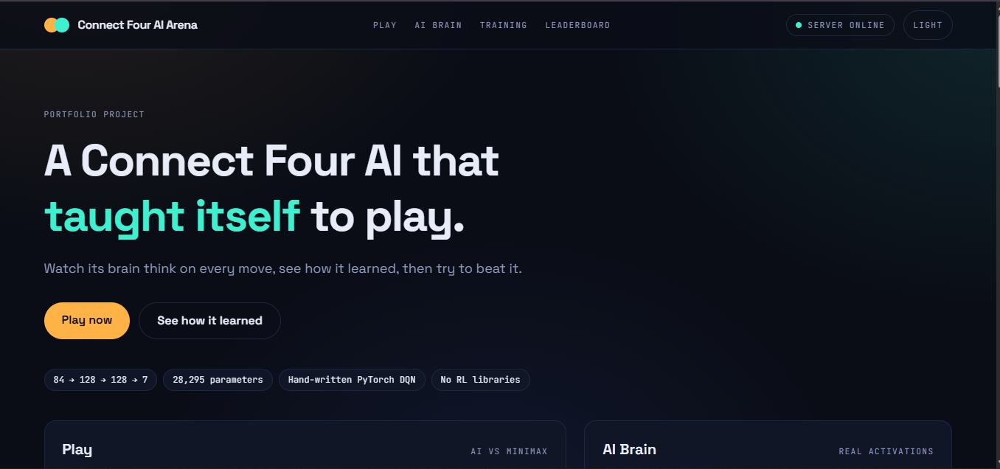
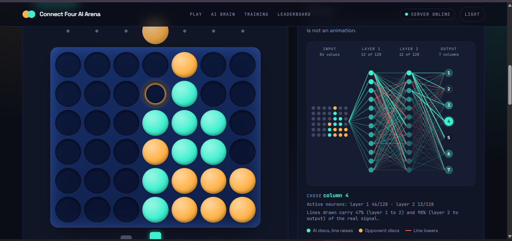
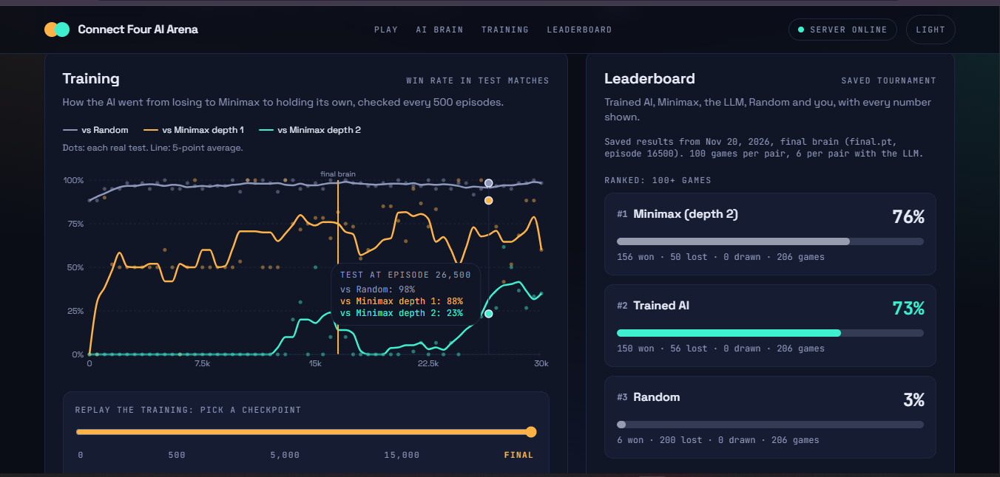
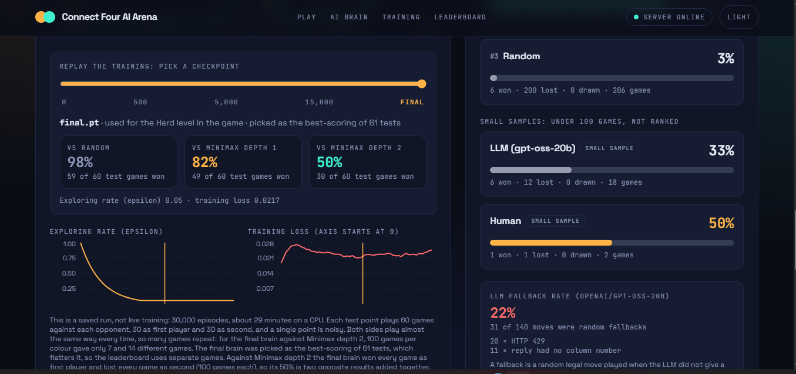
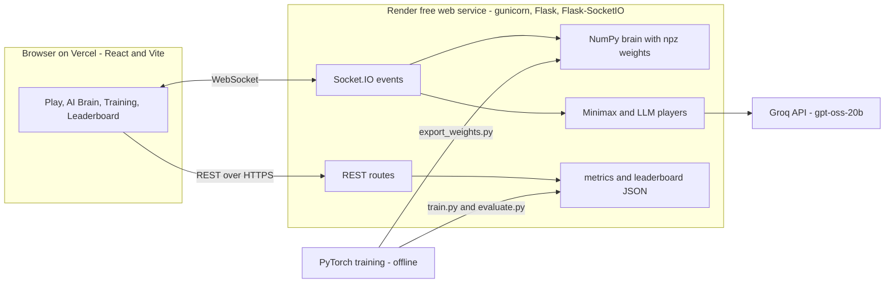

# Connect Four AI Arena

A Connect Four AI that taught itself to play, with a live view of its brain.

**Live demo: https://connect4-ai-arena.vercel.app**
(The server is on free hosting and sleeps when idle, so the first visit can take about a minute to wake up.)



## What this is

A small neural network (84 -> 128 -> 128 -> 7, 28,295 parameters) learns Connect Four by playing games. Every learning step is hand-written PyTorch. There is no Stable-Baselines3 or any other RL library. A Flask + Socket.IO backend serves the trained network, and a React frontend lets you play it, watch it play, and see which neurons fired for each move.

Game modes:
- **Human vs AI** with three difficulty levels (an early, a middle and the final training checkpoint)
- **AI vs Minimax** (depth 1 or 2), with a speed slider
- **AI vs LLM** (gpt-oss-20b through Groq), with a visible flag on every move where the LLM failed and a random move was played instead

## Screenshots


The board next to the AI Brain panel. The diagram is drawn from the real numbers of the move the AI just made.


The saved training run: win rate against Random, Minimax depth 1 and Minimax depth 2 (dots are real tests, the line is a 5-point average), plus a checkpoint slider.


The saved tournament, with small samples and the LLM fallback rate shown instead of hidden.

<!-- To add a demo GIF later: save it as docs/demo.gif and replace this line with:  -->

## How it works

### The model

The input is 84 numbers: two 6x7 planes, one for the discs of the player to move and one for the opponent's discs. The output is 7 Q-values, one per column; full columns are masked out. It is a plain fully connected network (no CNN), so the picture of the network in the UI is a faithful picture of the real model.

### Training (`ai/train.py`)

- DQN with a replay memory, a target network, epsilon-greedy exploration, a Huber loss and illegal-move masking.
- It learns from **both players' moves** with a negamax Bellman target: target = reward - gamma x max(target network over legal columns of the next state), where the next state is seen by the opponent.
- Curriculum of opponents: a tactical player, Random, noisy Minimax depth 1 and 2, plain Minimax depth 2, and frozen copies of its past selves.
- Left-right mirror augmentation, gamma 0.95, learning rate decaying from 5e-4 to 5e-5, winning moves stored 3 times.
- 30,000 episodes (about 29 minutes on a CPU). A test match is played every 500 episodes: 60 games against each of Random, Minimax depth 1 and Minimax depth 2, 30 as first player and 30 as second.
- The best-scoring checkpoint (episode 16,500, picked from 61 tests) was compared with the last brain on 100 fresh games per opponent. It won, so it was saved as `final.pt`.

### The AI Brain panel

The panel shows the real network for the move that was just made:
- the input as the 6x7 board the AI saw (its own discs vs the opponent's)
- the **12 strongest neurons of each hidden layer for that move**, out of 128
- the 7 output columns, with the chosen one highlighted
- lines whose strength is the real signal: source activation x trained weight

It is a slice of the network, and the panel says how big a slice. Over about 480 positions of games played by the final brain, the 12 shown layer 2 neurons carried on average 98% of the signal into the output (lowest position: 60%). The lines between layer 1 and layer 2 carried on average 52% (lowest: 39%). I first tried 12 evenly spaced neurons, but they carried only 4-6% of the output signal, so the panel shows the strongest ones instead. The trained network is sparse: for the final brain, on average only 8.9 of the 128 layer 2 neurons are active in a position, so some of the 12 shown are dark. The activations and line signals were checked against the real network: the largest difference is below 1e-6.

### Architecture



The deployed server runs the network in **NumPy**, not PyTorch. Render's free tier has 512 MB of RAM, and I did not want to depend on PyTorch fitting. `ai/export_weights.py` saves each checkpoint's weights as a small `.npz` file. I checked the NumPy version against the PyTorch model on about 1,900 game positions: the largest difference is below 1e-6 and both pick the same best column in every one of them.

## Results

Everything below was measured. The raw files are in `ai/` (`leaderboard.json`, `checkpoints/metrics.json`).

### Tournament (final brain, 100 games per pair, 6 per pair with the LLM)

| Player | Won | Lost | Drawn | Games | Win rate |
|---|---|---|---|---|---|
| Minimax (depth 2) | 156 | 50 | 0 | 206 | 75.7% |
| Trained AI | 150 | 56 | 0 | 206 | 72.8% |
| LLM (gpt-oss-20b) | 6 | 12 | 0 | 18 | 33.3% (small sample) |
| Random | 6 | 200 | 0 | 206 | 2.9% |

A win rate depends on who a player faced, so the head-to-head results are the fairer comparison:

| Match-up | Result | Games |
|---|---|---|
| Trained AI vs Minimax depth 2 | 50 - 50 | 100 |
| Trained AI vs Random | 95 - 5 | 100 |
| Trained AI vs LLM | 5 - 1 | 6 |
| Minimax depth 2 vs LLM | 6 - 0 | 6 |
| Minimax depth 2 vs Random | 100 - 0 | 100 |
| LLM vs Random | 5 - 1 | 6 |

**The 50 - 50 against Minimax depth 2 is two opposite results added together.** In a direct check (`ai/colour_check.py`), the trained AI won all 100 games when it moved first and lost all 100 when it moved second. Both sides play almost the same way every time, so those 100 games contained only 7 and 14 different games. Moving first is a large advantage in Connect Four, and I have not tested whether the second-player losses show a real weakness of the AI.

### Training curve (60 test games per point)

| Checkpoint | vs Random | vs Minimax 1 | vs Minimax 2 |
|---|---|---|---|
| Episode 0 | 88% | 0% | 0% |
| Episode 500 | 88% | 0% | 0% |
| Episode 5,000 | 100% | 60% | 0% |
| Episode 15,000 | 98% | 78% | 50% |
| Final (episode 16,500) | 98% | 82% | 50% |
| Last test (episode 30,000) | 98% | 60% | 35% |

The AI goes from 0% against both Minimax levels to 82% and 50%. Random is beaten from the start (the untrained network already wins 88% of games against it), so the interesting curves are the two Minimax ones. One point is only 60 games, so it moves by 1.7 percentage points per game won or lost, and the curve is noisy: the last test is lower than the selected checkpoint. Picking the best of 61 tests flatters that checkpoint, which is why the tournament above uses separate games.

### Difficulty levels

These numbers come from a separate 60-game test per checkpoint (different Minimax seeds from the training curve above, so they differ slightly from it).

| Level | Checkpoint | What I measured |
|---|---|---|
| Easy | `ep_500.pt` | beats Random 87% (52 of 60), loses all 60 games against Minimax depth 1 |
| Medium | `ep_5000.pt` | 58% against Minimax depth 1 (35 of 60), 0 of 60 against depth 2 |
| Hard | `final.pt` | 77% against Minimax depth 1 (46 of 60), 50% against depth 2 (the first-player result above) |

### The LLM

gpt-oss-20b ran through Groq's free tier (llama-3.3-70b returned 404 on my key). **22% of its moves (31 of 140) were random fallbacks**: 20 were rate-limit errors (HTTP 429) and 11 were replies with no column number. The LLM result is therefore a mix of real LLM moves and random ones, and 18 games is too small to rank it. The public site caps the LLM mode at 200 LLM moves per day to protect the free quota.

## What went wrong first

The first DQN versions failed in two ways: they overfit a few opponents, and they learned only from their own moves, so they almost never saw "win now" positions. Diagnostic scripts (`ai/diagnose.py`, `ai/qgap.py`) found both. Learning from both players' moves with a negamax target fixed the second one: missed immediate wins dropped from 59% to about 14%.

I also tried to make the AI vary its play. Adding randomness to its own moves made it much weaker: for the final brain against Minimax depth 1, a tiny tie-break margin (0.01) dropped it from 77% to 45%, and two random opening moves dropped it to 28%. So the AI plays deterministically, and the variety in the spectator modes comes from alternating colours and from the opponent's random seed.

## Limitations

- The AI plays the same game every time from the same position. Against Minimax depth 2 it won every game as first player and lost every game as second.
- Blocking is still its weak spot: it misses between 26% and 53% of single threats in my diagnostic.
- Test results are noisy (60 games per point, many repeated games), and the final checkpoint was selected from many tests.
- The LLM sample is tiny and its rate limits cause fallbacks. A full tournament with the LLM takes hours, so the site shows the saved results and never recomputes them.
- The Human row on the leaderboard is stored in a file on the server. Free hosting erases that file when the server restarts or sleeps, so the row can reset.
- Free hosting sleeps when idle: the first request can take about a minute.
- The AI Brain panel shows a slice of the network (12 strongest neurons per layer), not all 128, and it prints how much of the signal that slice carries.

## Run it yourself

Developed on Python 3.12. Backend (Windows shown; the server needs only NumPy, no PyTorch):

```
python -m venv .venv
.venv\Scripts\activate
pip install -r backend/requirements.txt
python backend/app.py
```

Frontend (the dev server forwards `/api` and `/socket.io` to port 5000):

```
cd frontend
npm install
npm run dev
```

Open http://localhost:5173. For the AI vs LLM mode, create a `.env` file in the project root with `GROQ_API_KEY=...` (optionally `GROQ_MODEL=openai/gpt-oss-20b`). Without a key the LLM falls back to random moves and the page flags every one.

Training and analysis need PyTorch (`pip install torch`; the CPU build is enough):

```
python ai/train.py --episodes 30000 --eval-every 500 --eval-games 60
python ai/diagnose.py final.pt
python ai/export_weights.py
```

`ai/evaluate.py` runs the tournament. **It overwrites `ai/leaderboard.json` unless you pass `--out`**, and the saved file includes hours of LLM games, so use another path:

```
python ai/evaluate.py --no-llm --out ai/leaderboard_local.json
```

Tests:

```
python backend/brain_np.py
python backend/games.py
python backend/app.py --test
node frontend/scripts/ws-check.mjs http://localhost:5173
```

## Project structure

```
ai/                  training and evaluation (PyTorch)
  connect4_env.py    the game
  model.py           the network
  agent.py           DQN agent
  train.py           training loop
  opponents.py       Random, Minimax, LLM and trained-AI players
  evaluate.py        round-robin tournament
  diagnose.py, qgap.py, colour_check.py   diagnostics
  export_weights.py  checkpoints to NumPy .npz files
  checkpoints/       saved brains, .npz weights, metrics.json
  leaderboard.json   saved tournament results
backend/             Flask + Socket.IO server (the server itself needs only NumPy)
  app.py, games.py, brain_np.py, requirements.txt
  brain.py           PyTorch version of the brain, for analysis
  neuron_*.py, tune_*.py   experiments behind the design choices above
frontend/            React, Vite, Tailwind, Framer Motion, Recharts
docs/                screenshots
render.yaml          Render blueprint for the backend
```

## Deployment

- **Backend:** Render free web service from `render.yaml` (gunicorn with one worker and threads, `simple-websocket` for WebSockets). Settings are environment variables: `GROQ_API_KEY`, `CORS_ORIGINS` (only the frontend's address), `LLM_DAILY_CAP`, `LLM_ENABLED`.
- **Frontend:** Vercel, root directory `frontend`. The backend's address is in `frontend/.env.production` as `VITE_API_URL`.

## Built with

Python, PyTorch, NumPy, Flask, Flask-SocketIO, gunicorn, React, Vite, Tailwind CSS, Framer Motion, Recharts, socket.io-client, Groq API.

## Author

Built by Muhammad Hafiz.
Portfolio: https://hafiz-portfolio-v2.vercel.app/ - GitHub: https://github.com/Hafiz12112003
